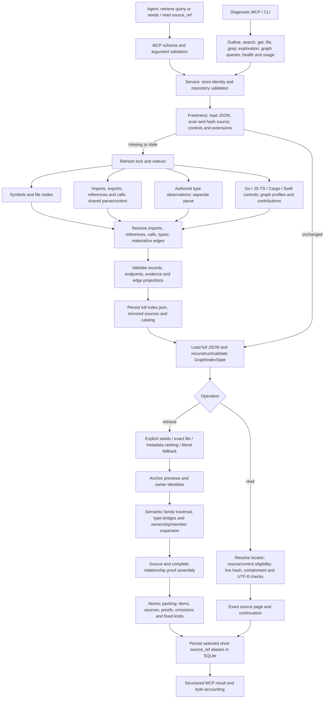

# Loci R0 — architecture and ablation assessment

2026-10-22. Serving revision: `f41b3eaa4c7871c68972de5f760572a6bcbe1760`. This is an architectural assessment and a proposal for review. No production redesign, integration, commit or publication was performed.

**Loci provides useful source and relationship capabilities, but the current architecture has not demonstrated the North Star of correct task completion with the least necessary information, time and computation.** Controlled retrieval ablations establish substantial evidence delivery on selected relationship fixtures. They also establish expensive whole-graph work on ordinary source reads. Removing graph enrichment loses capability; removing repeated parsing saves backend calls without a clear large-input indexing gain. Neither result establishes that the current persistent graph architecture is necessary.

The strongest architectural direction to test is a source-reading boundary independent of semantic graph reconstruction, alongside a genuinely graph-free retrieval control. The evidence does not support adopting a replacement design yet.

## Scope, provenance and evidence level

The primary checkout already contained R0.1 benchmark changes and reports. Their initial status and SHA-256 hashes are retained in [initial-status.txt](../../.scratch/loci-r0/initial-status.txt) and [initial-dirty-hashes.json](../../.scratch/loci-r0/initial-dirty-hashes.json). Serving `src/` matched the pinned commit. Detached experiments live inside `.worktrees/r0-control`, `r0-ownership`, `r0-validation`, `r0-selection` and `r0-parse`, each with isolated stores and source fixtures. Worktrees canonicalize to the primary repository in Loci's store logic, so an independent `LOCI_BASE_DIR` was essential. No experiment used a production catalog.

The [corrected R0.1 qualification](2026-10-22-r0-1-native-qualification.md) supplies reusable source snapshots, native readback, terminal accounting and independent evaluator machinery. Its completed controls are accepted within their documented scope. They are not task-comparison results. No Codex sandbox investigation or protection change was performed here. No live agent trial was necessary to answer the executed mechanism questions; overall task-level efficiency remains unresolved.

Two immutable corpora supplied existing source and relationship gold: TypeScript v3 has 17 cases, 71 source spans and 34 relationship links; multilingual has 19 cases, 116 spans and 50 links. Corpus SHA-256 values are `5d8f490a820f4e326aa522c2d963c8f0a56ea0c2d472f4d2b66caaeda9834b01` and `0337e8d40d91c1daa1132ca30be7e260797d6caac5531d3c139a79738ffda0a0`. Existing archive loaders verify source inventories and gold intervals. Applying the current engine to these inputs creates new R0 diagnostics; historical serving pins, freezes and results remain unchanged.

These corpora deliberately emphasize relationship and type-context problems. They cannot estimate ordinary-task prevalence. The expansion experiments supply the gold anchor to both conditions and perform one retrieval without hydration. They measure evidence acquisition after discovery. A missing full gold span can coexist with an available exact-read continuation, and a delivered relationship does not establish model reliance or successful task completion.

## 1. Implemented architecture

The shared service node represents entry into the relevant service operation. Diagnostic source/search operations need not load a semantic graph after freshness; diagnostic graph/exploration operations do. The diagram's normal branch always does. Failure results leave the relevant guard through a structured error rather than progressing to packing.

The executable entrypoints are [`loci` and `loci-mcp`](../../pyproject.toml). The maintained engine is local Python, tree-sitter/language-pack, pathspec, YAML, JSON files and a small SQLite source-reference store. There is no embedding index, vector search, LLM ranking service or networkx dependency in the installed project declaration.

### Request to source

1. **Transport and identity.** MCP selects either the two normal tools or a diagnostic catalog. Normal input schemas admit `repo/query/seed_ids` and `repo/source_ref`; traversal/ranking limits are internal. Store binding happens at stdio startup. Invalid arguments, repository/store errors and semantic contract errors have explicit failure paths. Successful source is in `structuredContent` with empty textual `content`. [Entrypoints and surface](../../src/loci/mcp_server.py#L193), [normal handlers](../../src/loci/mcp_server.py#L218), [error/output wrapping](../../src/loci/mcp_server.py#L737), [startup binding](../../src/loci/mcp_server.py#L766).
2. **Freshness and refresh.** Both normal handlers set `ensure_fresh=True`. An unchanged request still scans and hashes eligible source, recomputes module/extension input hashes and validates the stored graph. Missing/stale indexes enter the per-repository writer lock; freshness is rechecked after acquiring it. Schema, coverage, source/control drift, invalid graph state and unsafe extension paths can cause refresh. [Freshness](../../src/loci/service.py#L521), [staleness checks](../../src/loci/service.py#L1891), [repository scan](../../src/loci/service.py#L2222).
3. **Index compilation.** Source discovery applies exclusions and `.gitignore`, hashes source and records coverage. Changed code files are parsed for symbols, parsed again for a combined import/export/reference/call batch, and parsed separately for authored types where supported. Module controls establish native package/crate/module identities. Imports resolve before references; calls depend on references; types depend on imports/exports/references. Resolved records project to graph edges. Unresolved/unsupported observations and diagnostics remain explicit. [Indexer](../../src/loci/service.py#L167), [symbol extraction](../../src/loci/parser/extractor.py#L39), [semantic batch](../../src/loci/parser/imports.py#L129), [type extraction](../../src/loci/parser/type_observations.py#L69), [materialization](../../src/loci/graph/materialize.py#L233).
4. **Incremental behavior.** Equal-hash files reuse stored symbols and raw observations. Every refresh still rebuilds language indexes, resolves/materializes the full graph, validates it, replaces the source mirror and rewrites the complete index/catalog. Incrementality concerns extraction reuse; there is no graph delta or changed-file persistence path here. [Reuse](../../src/loci/service.py#L211), [full materialization](../../src/loci/service.py#L402), [full write](../../src/loci/storage/index_store.py#L276).
5. **Normal discovery.** After another full JSON load and graph reconstruction/validation, retrieval selects explicit IDs, then an exact relative file, then weighted metadata candidates, and uses literal source search only if metadata returns no anchor. Metadata ranking combines token specificity, field weights, phrase matching, query coverage and an explicit-identifier bonus. Literal lookup scans cached source in sorted file order and chooses the smallest containing declaration. Weak metadata can suppress an exact source phrase. [Graph load](../../src/loci/service.py#L2133), [selection order](../../src/loci/retrieval.py#L886), [ranking](../../src/loci/graph/anchors.py#L145), [field weights](../../src/loci/graph/anchors.py#L444), [literal search](../../src/loci/retrieval.py#L961).
6. **Context expansion.** Anchor source previews and file-owner identities are common to graph-on/off. Graph-on then builds request-local adjacency/degrees, prioritizes selected-anchor/type-bridge proof, interleaves call/type/value/import families and directions, and expands native ownership/member context. Only supported native `loci` edge families with allowed resolution tiers enter this traversal. The fixed policy allows two semantic hops; ownership lifts occur within a layer. Relevance is inferred from query/anchor/graph structure rather than supplied task acceptance criteria. [Main path](../../src/loci/retrieval.py#L83), [scheduler](../../src/loci/retrieval.py#L303), [ownership](../../src/loci/retrieval.py#L726), [edge eligibility](../../src/loci/retrieval.py#L837).
7. **Proof and packing.** The source adapter joins resolved records back to authored sites and module/control support. The packer deep-copies candidate state, assembles source/proof, renders and measures complete envelopes, rejects additions over limits, retains rollback snapshots and can remove additions at finalization. Defaults include 1,024-byte anchor previews, 768-byte related previews, 8,192 evidence bytes and 16,384 envelope bytes. Source items, source spans, node identities and relationships are separate representations with overlapping identity metadata. [Source/proof adapter](../../src/loci/_retrieval_source.py#L64), [atomic packer](../../src/loci/_retrieval_output.py#L83), [byte finalization](../../src/loci/retrieval_io.py#L52).
8. **Exact continuation.** `service.read` loads/validates the same full graph before resolving the short reference. The reference store is an alias table, not an authorization grant. The read path checks repository/path/extent, indexed source or resolver-control eligibility, current file hash, containment and UTF-8 boundaries; it returns a bounded exact page and a continuation. A source change refuses old references. Retrieval hydrates the mirrored source through `_CachedSource`; exact read additionally checks live bytes. [Read entry](../../src/loci/service.py#L1230), [reference store](../../src/loci/storage/source_refs.py#L1), [source validation and paging](../../src/loci/retrieval_io.py#L118), [mirror source cache](../../src/loci/type_context.py#L96).

Diagnostic/CLI paths include a separate metadata search scorer, exact symbol/file/grep routes, intent-based exploration, generic graph paths/neighbors/question retrieval, health and usage logs. Normal retrieval imports proof/source helpers from exploration, which imports the legacy type-context source cache. These are real dependencies even though the diagnostic tools are removed from the normal catalog. [Service families](../../src/loci/service.py#L552), [diagnostic search implementation](../../src/loci/storage/index_store.py#L475), [exploration](../../src/loci/exploration.py#L106), [generic graph retrieval](../../src/loci/graph/retrieval.py#L202).

### Original decisions and their current force

The [June graph design](../design/2026-06-10-graph-layer-design.md) followed a false bare-name cross-file edge that corrupted pathfinding. It motivated directed edges, supported resolution and source provenance. It also identified single-JSON scaling risk. Those motivations explain trust boundaries; its proposed orientation/community features are not evidence of current task value and are not installed engine dependencies.

The [July extensible-graph design](../design/2026-07-13-extensible-graph-retrieval-design.md) aimed at a common graph substrate for code and domain consumers, profiles and external contributions. Normal retrieval now filters to native code edge families, while extensions still participate in parsing metadata, freshness and storage. A generic substrate is therefore an obligation whose normal-task value needs separate evidence. Existing diagnostic consumers prevent calling it unused solely because the normal tool omits those edges.

The type extractor explicitly justifies a separate parse by declaration ownership versus executable ownership and preserving the earlier payload. Separate semantic analyses remain meaningful; the parse-reuse experiment tests whether they require separate backend parsing. The [coverage/store plan](../plans/2026-07-30-loci-trustworthy-coverage-and-store-lifecycle.md) motivates explicit misses/coverage, repository inventory and recoverable writes. The [September source-first review](2026-09-29-scalpel-review.md) identifies weak-metadata suppression, failed traversal admission and expensive exact reads. Current traversal still marks a target visited before proof/admission succeeds; a later path can lose source-item/frontier eligibility. R0 confirmed that code path but did not estimate its incidence or fix it. [Current admission state](../../src/loci/retrieval.py#L415).

## 2. Responsibility, dependency and ablation map

Classifications apply to the stated capability and workload. “Justified” establishes a contribution here; it does not approve the whole implementation or prove optimality. “Redundant” is limited to work for which an equivalent tested path exists. An unexecuted replacement remains a hypothesis.

| Subsystem and responsibility | Dependents / independent ablation seam | Evidence that would earn its complexity; reusable fixture | Assessment |
| --- | --- | --- | --- |
| Symbol extraction and exact byte extents | Discovery, source refs, record owners, all graph endpoints. Replace with file/literal navigation only as a coherent alternative; removing symbols alone invalidates downstream inputs. | Correct relevant source acquisition versus native file/literal navigation, including nested/duplicate names. Existing retrieval and frozen corpus spans. | **Justified** for accurate symbol source; necessity of tree-sitter for every task **unproven**. |
| Import/export/reference/call syntax and binding analyses | Resolution, supported edges and proof. Calls depend on references; references depend on imports/exports. Disable coherent families and their projections/validators together. | Required evidence/known-call acquisition and negative wrong-origin controls. `test_retrieval.py`, normal acceptance, multilingual call/uncertainty cases. | **Justified** conditional capability; individual extraction-family cost/value **unproven** because enrichment-off retains all extraction. |
| Authored type analyses | Type edges, signature bridges and proof; semantic ownership differs from call ownership. Remove type observations through all downstream stages as one experiment. | Necessary type-contract spans with preserved shadowing/uncertainty. TypeScript v3, multilingual type cases and type-relation tests. | **Justified** on selected type tasks; universal eager compilation **unproven**. |
| Repeated backend parses | All extractors consume trees but can retain independent walks/ownership. Operation-local exact grammar+bytes reuse is independently testable. | Identical symbols/records/edges/errors and lower total indexing resources. Executed parse ablation. | **Redundant** parsing work in tested snapshots; proposed cache's end-to-end benefit **questionable**. |
| Language module/package/crate controls | Imports, references, calls and types; native identities and proof. Language resolver cuts interact with several edge families. | Correct authored origins versus missing/wrong targets; module/config negative cases. Go/Cargo/JS-TS corpus and existing resolver tests. | **Justified** for supported conditional resolution; Swift task utility and family-level net costs **unproven** here. |
| Profiles, contributions and Markdown metadata overlays | Generic diagnostics, domain consumers, input freshness; frontmatter can alter extraction/ranking. Disable extensions coherently, not just delivered edges. | A named consumer task gains needed evidence at acceptable setup/refresh/output cost. Existing profile/contribution tests establish contracts only. | **Unproven** for the North Star on current normal code tasks. |
| Raw/resolved records plus projected edges | Resolvers, diagnostics, proof joins, unresolved omissions and traversal. Dropping raw/support fields can destroy proof/reindex reuse. | Equivalent trustworthy delivery with less persisted/decoded state. Existing corpus gold and record corruption tests; representation removal not executed. | **Unproven** representation necessity; measured storage/reconstruction burden makes it a priority. |
| Full graph reconstruction/validation on every normal read | Freshness, `_load_graph_context`, control eligibility. Cache repeated identical inputs independently; graph-free read requires a narrower eligibility/source boundary. | Equal packets/rejections with lower operation cost. Executed content-key cache plus 67 focused tests. | Trust validation **justified**; repeated reconstruction of unchanged inputs **questionable**, duplicate work demonstrated. |
| Metadata ranking and literal fallback | Anchors for normal and diagnostic graph discovery. Exact seeds/files remain separable. | Correct target selection, necessary evidence and lookup cost across ordinary, ambiguous and mixed literal queries. Executed seven-case selection ablation. | **Questionable** current precedence; blanket literal-first replacement also unsupported. |
| Semantic expansion, family scheduling and type bridges | Related evidence/proof; downstream packer. Existing graph-enrichment switch skips the whole expansion stage. | Required source/link delivery versus alternatives and eventual completion/resources. Executed 36-case ablation. | **Justified** for selected one-packet evidence delivery; automatic policy and precise scheduler complexity **unproven**. |
| Representative native-owner member expansion | File/package/crate/module declarations enter source and traversal. Disable member lifts while preserving symbol-owner identities/lifts. | Additional necessary source/proof worth its output and expansion cost. Executed member-off ablation. | **Justified** for some fixtures; blanket expansion's net task value **questionable**. |
| Complete proof assembly and honest uncertainty | Trustworthy relationships and downstream reasoning. Bypass changes the contract and must count unsupported assertions as failures. | Correct evidence origins and rejection of unsupported dispatch/changed source. Frozen scorers, wrong-origin/unsupported-call/record tests and historical fabrication failure. | Trust boundary **justified**; current completeness consistency **questionable** because five claims fail stricter persisted-support scoring. |
| Atomic packing, previews, quotas and rollback | Bounded delivery, source refs and complete proof groups. Each policy can be varied separately from graph extraction. | More necessary evidence or lower whole-task cost without malformed proof or silent omission. High-fanout, large-anchor, shared-type and UTF-8 tests plus source gold. | Atomic completeness **justified**; fixed numerical policy and repeated copy/render machinery **unproven**. |
| JSON index, mirrored sources, catalog and refresh locking | Every service operation, snapshot fidelity, overlapping-root and interrupted-write behavior. Source mirror or storage format cuts need coherent snapshot/ownership replacement. | Equal freshness/replay/concurrency protection at lower material cost. Existing storage/lifecycle tests plus measured Anvil read/index path. | Persistence/ownership capability **justified**; monolithic representation/full rewrites **questionable**. No database replacement selected. |
| Short source refs and exact continuation | Every preview and read; SQLite alias state can be replaced by self-contained locators independently. | Exact UTF-8 reconstruction, bounded output, stale/foreign rejection and fewer total bytes/rounds. Source-ref/read tests; historical binding workflow. | Exact continuation **justified**; need for persistent aliases versus alternate locators **unproven** in R0. |
| Diagnostic exploration/search/graph/usage surfaces | CLI/operators and normal-path source/proof helpers. Public surface removal alone does not remove imported implementation. | Named operator/agent outcomes and lower total acquisition work. Historical diagnostic fixtures and usage logs do not isolate value. | **Unproven** as a combined normal-task architecture; do not infer redundancy from catalog visibility. |

The detailed [index/storage trace](../../.scratch/loci-r0/index-architecture.md) and [evaluation inventory](../../.scratch/loci-r0/evaluation-evidence.md) contain additional source and fixture locators.

## 3. Controlled ablations

The [pre-run corpus protocol](../../.scratch/loci-r0/corpus-protocol.md) fixes requests, gold and normal-packet scoring. Source bytes/hashes and complete packet shapes are independently checked. Existing relationship scorers are reused through a small in-memory packet adapter; structural import edges remain in raw results and are source-validated, while semantic-link scoring uses its historical narrower edge domain. TypeScript's existing `references_type` fallback credits a dependency link, not necessarily the precise semantic relation kind. The Markdown anchor mismatch is retained and both arms use the same exact-file request.

The first corpus pass exposed adapter mismatches; it is retained separately. Corrected outputs and any subsequent measurement-scope correction are identified in the corpus report rather than overwriting an earlier attempt. This is a small experiment driver using existing materializers/scorers, not a new evaluation framework.

### Source and relationship delivery

| Corpus / intervention | Full gold source spans | Cases with every span | Gold relationship links | Total packet bytes |
| --- | ---: | ---: | ---: | ---: |
| TypeScript control | 63/71 | 15/17 | 26/34 | 130,055 |
| TypeScript enrichment off | 16/71 | 0/17 | 0/34 | 39,454 |
| TypeScript representative members off | 57/71 | 11/17 | 23/34 | 124,268 |
| Multilingual control | 105/116 | 15/19 | 47/50 | 191,320 |
| Multilingual enrichment off | 19/116 | 1/19 | 0/50 | 41,376 |
| Multilingual representative members off | 99/116 | 12/19 | 45/50 | 166,371 |

**Enrichment-off loses capability in the current one-packet interface.** Across both corpora, full source-span coverage drops from 168/187 to 35/187; 73/84 delivered gold links become zero. It reduces output from 321,375 to 80,830 bytes. Both conditions retain indexing, graph loading, source selection, previews, owner identities and exact continuation. These numbers do not test a graph-free architecture or an agent using native search and follow-up reads. In particular, native readers can access Go/Cargo controls without graph machinery; delivering those files through the graph is a current-interface advantage, not proof that a graph is intrinsically required.

**Representative members are not uniformly disposable.** Removing them saves 30,736 packet bytes (9.6%) but loses 12 fully covered gold spans, five gold links and seven cases' all-source status. The mechanism can recover declarations reached through native import/owner endpoints. It also introduces incidental context. The scoped result rejects blanket removal; it does not establish that every default member or every expansion is relevant.

Both controls remain incomplete: 19 gold source spans and 11 gold links are absent from the baseline. Full-span gold, preview truncation, omitted paths and unavailable static semantics all contribute possible limits; the per-case outputs identify the observed omissions. A bounded packet being valid does not mean it is sufficient.

The final direct measurements load and validate graph inputs before timing `retrieve_context`; they retain its internal source/index work and packing. They exclude repository refresh and service-level graph loading. Each entry below is the median of per-case medians from three repetitions, in milliseconds. Fixed arm order, concurrent local work and selected tiny fixtures limit latency interpretation.

| Direct experiment / corpus | Wall control → intervention | CPU control → intervention |
| --- | ---: | ---: |
| Enrichment / TypeScript | 5.074 → 2.174 | 3.348 → 1.252 |
| Enrichment / multilingual | 10.536 → 2.318 | 9.287 → 1.334 |
| Representative members / TypeScript | 4.418 → 3.852 | 3.259 → 2.794 |
| Representative members / multilingual | 10.189 → 7.438 | 9.242 → 5.990 |

These savings are traversal/assembly observations and cannot be subtracted directly from the separate seconds-long full-service Anvil timings. The independent controls in the two member/enrichment worktrees deliver the same coverage and packet-byte totals. [Corpus results and limitations](../../.scratch/loci-r0/corpus-ablation.md), [direct enrichment raw results](../../.scratch/loci-r0/corpus-control-direct/results.json), [direct member raw results](../../.scratch/loci-r0/corpus-ownership-direct/results.json).

Five baseline call claims—three TypeScript/Anvil and two maintained Loci/Python—are valid normal packet shapes with exact source/evidence-line attribution but fail the older scorer's stricter persisted-support completeness check. They remain uncredited and explicitly uncertain in raw `delivery_integrity_violations`; the same five persist with members disabled. The independent raw relationship readback finds no detached or wrong-file/hash/line evidence links across all 432 direct calls. That narrower check does not resolve the semantic-support discrepancy. R0 neither promotes the five claims to fully established proof nor calls them fabricated edges. This limitation affects the proof-assembly classification and remains an unresolved contract question. The final direct runner copies are exact retained source; intermediate service-run runners were reconstructed without original source digests, so those earlier versions' exact identity remains unverified. The final direct runs own the reported timing and comparison.

### Other executed architectural mechanisms

| Mechanism and intervention | Control → candidate | What the result establishes | Limit / disposition |
| --- | --- | --- | --- |
| Metadata-first → literal-first, metadata fallback | Mixed `connection reset §42§`: wrong anchor/target absent → correct function. Ordinary symbol/type queries add a six-file/548-byte scan; a named type leaves the anchor set for earlier references. Exact file/seeds remain identical. | Current precedence can suppress exact evidence; literal occurrence order can also harm direct precision. | Seven diagnostic requests, single timing samples. Graph recovers displaced type in this fixture. **NO-GO** for blanket literal-first. [Report/diff](../../.scratch/loci-r0/selection-ablation.md). |
| Reconstruct/validate every time → content-keyed private-state reuse | Anvil full fresh read median 3,718 → 3,383ms; retrieve 4,075 → 4,036ms. Complete packets equal. Cache still serializes/hashes validation inputs and deep-copies typed state. | Duplicate validation work exists; a guarded cache displaces much of it into other computation. | Two snapshots, three warm repetitions; ~9% read and ~1% retrieval gain, no broad or peak-memory claim. **INCONCLUSIVE** for adoption. [Report/raw/profile](../../.scratch/loci-r0/validation-ablation.md). |
| Independent backend parses → exact grammar+bytes tree reuse inside one index operation | 913 of 1,388 backend parses avoided across 63 paired comparisons; all persisted indexes exactly equal, 17 sampled normalized packets equal. Anvil 455 parses → 161, semantic walks unchanged. | Repeated backend parsing is avoidable without merging ownership analyses. | Instrumented aggregate wall improves 1.3%; large Anvil pair changes direction across order, with ~53 MB higher Python-traced peak heap. Parser calls alone overstate value. [Parse report](../../.scratch/loci-r0/parse-ablation.md). |

The focused production control has **67 passing** retrieval, enrichment, exact-read, normal-acceptance and source-reference tests. The validation candidate passes the same 67. Selection's 18 retrieval checks, 25 relevant relationship-scorer tests and four focused parser checks pass. The parser log retains an initial nonexistent pytest node and its corrected successful invocation. These checks protect experimental interpretation and contracts; none is scored as an agent-value win.

## 4. Bottlenecks, coupling and unnecessary work

**Semantic reconstruction dominates a source-read path.** The maintained Anvil source archive has 187 files, of which 163 eligible files produce 2,284 symbols and 4,532 edges. Full fresh read loads the index three times, scans source once and reconstructs/validates graph state twice. A separate profiled control attributes 8.54 of 9.27 cumulative seconds to the two graph-validation calls, including 7.37s in `GraphIndexState.from_dict` and 1.17s in semantic record/edge validation. Profiling inflates time; the unprofiled read median is 3.718s. The observed burden is substantially representation conversion, not just trust checking. [Raw counts and profile](../../.scratch/loci-r0/validation/results.json).

**Persistence expands and rewrites much more than the source.** This input's index JSON is 73,747,104 bytes against 1,910,473 mirrored source bytes, approximately 38.6×. Resolved records retain raw observations, bindings and support while edge projections retain another identity/evidence representation. Those records have consumers: proof, diagnostics, unresolved omissions and incremental extraction. Size alone does not justify deleting them. The demonstrable cost comes from decoding/reconstructing the entire representation repeatedly for a narrow request. One explicit no-change index pass took 3.919s against 4.270s cold, despite parse reuse. These are single indexing observations, not a standalone storage ablation.

**“Off” switches can leave nearly all architectural cost intact.** Enrichment-off removes automatic relationships/member context but retains graph compilation/storage/validation and proof-adapter initialization. It cannot estimate the savings from removing the persistent graph, resolvers or semantic parsing. Similarly, hiding extension edges or diagnostic tools leaves their state and source-helper dependencies in place. Coherent subsystem ablation must follow dependencies through extraction, persistence and consumption.

**Discovery failure precedes graph sophistication.** A wrong initial anchor can exclude necessary source before traversal begins. Metadata ranking, literal scanning, generic graph question ranking, intent exploration and legacy diagnostic search are distinct policies. Their coexistence creates maintenance obligations; equivalent behavior has not been demonstrated, so “duplicate ranking code” is not sufficient evidence to delete one. The selection experiment supplies a concrete failure and a rejected simple alternative.

**Selection and packing interact.** Representative members add both source and expansion frontiers, so removing them changes which later proof fits. Type bridges and family fairness compensate for shared output limits. Marking unsuccessful targets visited can suppress later admissible evidence. The packer copies, renders and serializes candidates repeatedly, with rollback snapshots. These mechanisms are coupled; the present evidence does not isolate a benefit for every scheduler rule or numerical quota.

**Wire context is much larger than unique evidence.** The control's 321,375 packet bytes carry 25,356 bytes of unique source intervals across these requests, about 12.7×. The denominator is unioned source intervals per file/hash; the numerator also includes repeated source representations, identifiers, hashes, proof, omissions and JSON framing/escaping. This is a measurement of representation overhead, not a claim that all non-source bytes are unnecessary. Bytes/4 estimates in packets are not observed provider tokens.

**Backend parse reuse does not remove the expensive semantic walks and storage path.** All ownership, binding, extraction, resolution and validation passes remain. Its nearly two-thirds reduction in backend calls on Anvil yields no clear large-input total-time gain under matched instrumentation. It is a supported redundancy, with low demonstrated leverage on the measured bottleneck.

## 5. Existing task-value evidence and unresolved hypotheses

The retained [normal-adoption result](2026-09-14-normal-graph-adoption-result.md) has 8/8 Loci invocation, 6/8 positive graph delivery and 5/8 complete fact answers, with five cost-gate failures. The [later binding comparison](2026-09-15-schema-repair-token-result.md) delivered 43 relationships across seven retrieves but neither answer supplied every compound fact; median gross input was 1.5325× its original baseline. Cached input explains most of that excess; it is not billed-dollar evidence. Neither comparison isolates graph causality.

The [multilingual workflow measurement](2026-09-13-multilingual-workflow-measurement.md) retains 114 attempts, but only 51 complete measurements, 44 exact answers and 11 full passes; only the single Markdown task passed its full workflow gate. The [measurement-defect review](2026-09-13-multilingual-measurement-defects.md) limits programming-language comparisons because of graph accounting, asymmetric control-file access and answer-contract issues. Those limits remain; R0 does not rescore historical attempts.

The older [storage-cost review](2026-09-13-storage-cost-decision.md) correctly withheld a storage redesign from mixed whole-operation timings. R0 now supplies a specific maintained-source latency and phase attribution that warrants a narrower architectural experiment. It still does not identify the best database, cache or retrieval design.

Unresolved questions that matter to the North Star:

- Can native literal/file navigation plus exact spans reach task sufficiency with less overall work once the agent can follow references itself? The graph-off diagnostic cannot answer this.
- Which graph families avoid otherwise necessary search/read/reasoning, and how often does that occur in ordinary tasks? Selected relationship fixtures establish capability, not prevalence.
- Can a lightweight source snapshot/eligibility boundary preserve trusted reads and control-file access without loading semantic records? Current full-graph coupling is implementation evidence, not an inherent requirement.
- Is eager whole-repository resolution preferable to demand-driven resolution of selected anchors? Reverse callers and cross-file invalidation may require broader knowledge; the tradeoff is untested.
- Which baseline gold omissions are preview-only and recoverable cheaply, versus selection/proof/static-resolution failures? One-packet scores preserve that ambiguity rather than inventing agent recovery costs.
- Would smaller identity/proof framing reduce useful-context cost, or merely shift necessary validation and uncertainty into the agent? No wire-format ablation or provider-token comparison ran.
- Do the five normal-call claims withheld by the older proof scorer lack necessary semantic support, or does that scorer require a larger historical proof contract than the current source-site adapter? Source attribution alone cannot settle this discrepancy. It does not justify claiming either complete proof or invented edges.

## 6. Alternative designs and recommended next experiments

These are hypotheses for review, not approved designs. Each could fail while leaving the current capability useful.

| Alternative | What could disappear | Capability/trust at risk | Experiment that changes the decision |
| --- | --- | --- | --- |
| Graph-free native/source core | Eager semantic extraction/resolution, record/edge persistence, graph reconstruction and automatic expansion | Deterministic origin/call/type proof and one-packet discovery of related declarations | Compare current engine with native file/literal tools and a minimal exact-source control on the existing archived tasks; preserve native control-file access. Count all follow-up acquisition before claiming equivalence. |
| Lightweight source index with demand-driven semantics | Whole-repository semantic state for tasks requiring only local evidence | Reverse callers, re-exports, package boundaries and invalidation completeness | Resolve only the selected evidence neighborhood on existing positive/uncertainty cases; record setup plus subsequent reads/resolution and missing capabilities. |
| Retained graph with an independent exact-source boundary | Repeated semantic reconstruction on continuation/read and some duplicated full-index loads | Source/control eligibility, snapshot identity, stale rejection, concurrent refresh | Test a direct source-read branch retaining containment/hash/UTF-8/eligibility/page safeguards on the same small and Anvil snapshots. Compare full packets and negative controls before measuring saved resources. |
| Selective relationship acquisition instead of unconditional broad expansion | Incidental representative members, repeated automatic context and quota-compensation rules | Necessary bridge/member evidence demonstrated in R0 | Use the retained per-case gain/loss records to compare anchor-first continuation with the current fixed policy. A new public interface is a separate design decision. |

**Recommended first experiment:** isolate exact-source reading from semantic reconstruction. Its question is concrete: can the identical authorized source page, stale/error behavior and control eligibility be provided without loading or rebuilding all graph records? The measured seconds-long cost makes a positive result consequential, while its contract is already well specified. Reuse the validation fixtures and source-reference/continuation tests; do not start by choosing a new storage technology or tuning the current cache.

**Recommended next substantial ablation:** a genuinely graph-free source acquisition control, following removal through indexing, storage and request execution. This asks whether the graph architecture earns its total cost rather than whether one automatic packet contains useful related source. Reuse the archived fixtures first, with equal source/control access and fixed requests; use R0.1 native full-work readback and existing oracles only where deterministic evidence cannot distinguish competing task-level hypotheses. Ordinary task selection must be independent of graph structure before a broad utility claim.

**Subsequent experiments, if those results leave a relevant gap:** remove individual semantic families coherently; compare demand-driven versus eager resolution; vary discovery precedence using the recorded mixed-literal and named-declaration counterexamples; then test compact proof/identity delivery. Backend parse caching and general literal-first ranking are lower priorities after the observed results. These are recommendations, not an authorized campaign or integration plan.

The assessment ends here. [Preservation readback](../../.scratch/loci-r0/preservation-check.json) confirms all 67 pre-existing dirty files retain their initial hashes and production `src/` matches the pinned commit. The experimental artifacts remain available for review and disposal.
